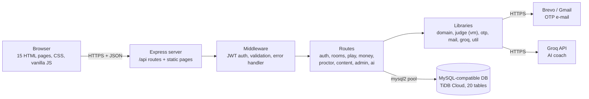
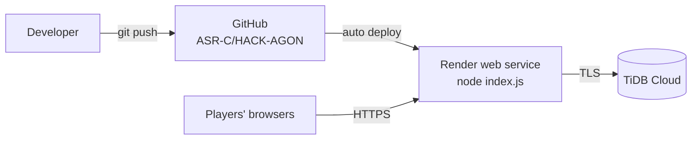

# HackAgon

**Host and join online coding competitions.** Free practice rooms, paid tournaments with escrowed prize pools, and proctored matches with webcam and tab-lock checks.

> The host controls the contest. The platform controls the money and the integrity.

Live demo: https://hack-agon.onrender.com (free Render instance, the first request after a pause can take about a minute)

---

## Table of Contents

1. [About](#about)
2. [Features](#features)
3. [Software Requirement Specification (summary)](#software-requirement-specification-summary)
4. [System Architecture](#system-architecture)
5. [Tech Stack](#tech-stack)
6. [Project Structure](#project-structure)
7. [Getting Started](#getting-started)
8. [Environment Variables](#environment-variables)
9. [Database](#database)
10. [How It Works](#how-it-works)
11. [Tournament Money Flow](#tournament-money-flow)
12. [Anti-Cheat (Tournament Mode)](#anti-cheat-tournament-mode)
13. [Testing](#testing)
14. [Deployment](#deployment)
15. [Team and Week-wise Work](#team-and-week-wise-work)
16. [Current Status, Limits and Future Scope](#current-status-limits-and-future-scope)
17. [License](#license)

---

## About

Existing coding platforms are run by the platform itself. Students, clubs and small groups cannot easily host their own contests, set their own rules and prize splits, and trust that the money and the fairness are handled for them.

HackAgon is a single place to practise, compete and learn. Any verified user can create a room or tournament in a few minutes with sensible, editable defaults.

| User | Need |
|---|---|
| Student / learner | Practice, duels, a review of past mistakes, free learning books |
| Competitive player | Matches, tournaments with prizes, achievements |
| Host (individual, club) | Run a contest for friends, a class or a college event |
| Platform admin | Manage the question bank and library, review users, resolve disputes |

All counters in the product (rooms won, achievements) start at zero for every new account and grow only from real activity.

---

## Features

**Accounts**
- Sign-up with name, username, e-mail, mobile, password and date of birth
- 6-digit OTP by **e-mail** (stored as a bcrypt hash, 5 min expiry, 5 attempts, resend after 60 s)
- Login with e-mail or username, JWT sessions (7 days), forgot-password by OTP

**Rooms and formats**
- Create rooms with editable defaults: name, format, capacity, languages, topics, questions, duration, visibility, prize pool, entry fee, proctoring
- Formats: **Solo**, **Duo**, **Squad**, **Duel**
- Public rooms in the Arena, private rooms by invite code
- Live scoreboard, final ranks, scoring by question points plus a time bonus (2 points per remaining minute), ties broken by the earlier last correct submission

**Judge and question bank**
- Hidden test cases stay on the server
- JavaScript is really executed (Node `vm`, 2000 ms timeout); other languages use a deterministic simulation and are flagged `simulated: true`

**Learning**
- *My mistakes*: last code, failing case and retry
- Library of 11 free books with licence shown
- 7 achievements: First Blood, Room Master, Tournament Conqueror, Duelist, Perfectionist, Clean Player, Scholar
- AI coach (Groq) for hints and explanations

**Paid tournaments**
- Host funds the prize pool, entry fees are escrowed, a published split pays the winners
- Presets: winner takes all, top 3 (50/30/20), top 5 (40/25/15/10/10), custom
- **1% platform fee on the prize pool only**
- Append-only ledger, disputes block payout, refunds
- The payment gateway is simulated in this build (see Current Status)

**Host and admin tools**
- Host dashboard with live players, violations, snapshots, unlock and eliminate
- Admin back office: question bank, library review, users, disputes, money totals

---

## Software Requirement Specification (summary)

The full document is in [`docs/HackAgon_SRS.pdf`](docs/HackAgon_SRS.pdf).

### Functional requirements

| ID | Requirement |
|---|---|
| FR1 | Sign up, verify by e-mail OTP, log in, reset password |
| FR2 | Create rooms in solo, duo, squad and duel formats with public or private visibility |
| FR3 | Create tournaments with entry fee, funded prize pool, prize preset and optional proctoring |
| FR4 | Judge submissions against hidden test cases; award points plus time bonus; record failures as mistakes |
| FR5 | Camera gate, snapshots, tab-lock on any violation, host unlock or eliminate |
| FR6 | Finalise a room, rank players, settle prizes after the 1% fee, write every money movement to a ledger |
| FR7 | Mistake book, free library, achievements, AI coach |
| FR8 | Admin tools: questions, books, users, disputes, money totals |

### Non-functional requirements

| Area | Requirement |
|---|---|
| Security | bcrypt for passwords and OTPs, signed JWTs, parameterised SQL only, secrets only in environment variables, hidden tests never sent to the browser |
| Integrity of money | Integer paise only, append-only ledger, transactions around settlement |
| Usability | Works at phone width, bottom navigation on small screens, readable contrast |
| Portability | Any host with Node.js 18+ and a MySQL-compatible database |
| Maintainability | Routes, domain rules, judge, mail and AI in separate modules |

### Software and hardware requirements

| Item | Requirement |
|---|---|
| Server runtime | Node.js 18 or newer |
| Libraries | express 4, mysql2, bcryptjs, jsonwebtoken, nodemailer, cors, dotenv |
| Database | MySQL 8 compatible (TiDB Cloud in production) |
| Client | Modern desktop browser; webcam for proctored rooms |
| Developer machine | 4 GB RAM, Git, a code editor |

---

## System Architecture



HackAgon is a three-tier application served from one origin. The browser loads static pages from the Express server and calls the JSON API under `/api`. The server talks to the database through a pooled connection and to two outside services: an e-mail service for OTPs and the Groq API for the AI coach.



---

## Tech Stack

| Layer | Choice |
|---|---|
| Front end | HTML, CSS, vanilla JavaScript (15 pages, no build step) |
| Back end | Node.js 18+, Express 4 |
| Database | MySQL protocol through `mysql2` (TiDB Cloud in production, MariaDB for local tests) |
| Security | `bcryptjs`, `jsonwebtoken` |
| E-mail | `nodemailer` with Gmail SMTP, or Brevo over HTTPS when `BREVO_API_KEY` is set |
| AI coach | Groq chat completions (`openai/gpt-oss-120b`) |
| Hosting | Render (web service) and TiDB Cloud (database), code on GitHub |

> Render's free tier blocks outbound SMTP ports, so on Render the OTP e-mail goes through Brevo's HTTPS API.

---

## Project Structure

```
HACK-AGON/
├── index.html, login.html, signup.html, verify-otp.html
├── arena.html, create-room.html, create-tournament.html
├── tournaments.html, tournament-details.html
├── duel.html, match.html, host-dashboard.html
├── learning.html, profile.html, admin.html
├── css/        base.css, auth.css, components.css, theme.css
├── js/         api.js, app.js, store.js, create.js, seed.js
└── server/
    ├── index.js  config.js  db.js
    ├── schema.sql  migrate.js  seed.js  smoke.js
    ├── make-admin.js  fix-admin.js
    ├── routes/   auth, rooms, play, money, proctor, content, admin, ai
    └── lib/      auth, domain, judge, otp, mail, groq, util, repo
```

**Working rules**
- Routes read input and call library functions; the front end only talks to `/api`.
- Every SQL statement uses parameters.
- Money is stored as integer paise, never floating point.
- Every secret comes from environment variables, never from the repository.

---

## Getting Started

### Prerequisites
- Node.js 18 or newer
- A MySQL-compatible database (local MySQL or MariaDB, or a TiDB Cloud cluster)
- Optional: a Gmail app password or a Brevo API key (OTP e-mail), a Groq API key (AI coach)

### Run locally

```bash
# 1. Clone
git clone https://github.com/ASR-C/HACK-AGON.git
cd HACK-AGON/server

# 2. Install
npm install

# 3. Create server/.env from the example and fill in your database values
cp .env.example .env

# 4. Create the 20 tables and load starter data
npm run setup        # same as: node migrate.js && node seed.js

# 5. Start
npm start
```

Open `http://localhost:PORT` (the `PORT` value in your `.env`). To make yourself an administrator, add your e-mail to `ADMIN_EMAILS` before signing up, or run `node make-admin.js you@example.com`.

---

## Environment Variables

Never commit these. `.env` is in `.gitignore`.

| Variable | Purpose |
|---|---|
| `PORT` | Port the server listens on |
| `DB_HOST`, `DB_PORT`, `DB_USER`, `DB_PASSWORD`, `DB_NAME` | Database connection |
| `DB_SSL` | `true` for TiDB Cloud |
| `JWT_SECRET`, `JWT_EXPIRES_IN` | Session signing key and lifetime (`7d`) |
| `EMAIL_HOST`, `EMAIL_PORT`, `EMAIL_SECURE`, `EMAIL_USER`, `EMAIL_APP_PASSWORD`, `EMAIL_FROM_NAME` | Gmail SMTP for OTP e-mail |
| `BREVO_API_KEY`, `BREVO_SENDER` | OTP e-mail over HTTPS (use on Render) |
| `GROQ_API_KEY`, `GROQ_MODEL` | AI coach |
| `EXPOSE_OTP_IN_RESPONSE` | `true` echoes OTP codes in API responses for testing; set `false` in production |
| `ADMIN_EMAILS` | Comma-separated e-mails that become administrators |

---

## Database

20 tables: `users`, `otps`, `topics`, `languages`, `prize_presets`, `questions`, `books`, `achievements`, `ach_state`, `rooms`, `room_players`, `submissions`, `mistakes`, `violations`, `snapshots`, `payments`, `payouts`, `ledger`, `disputes`, `notifications`.

**Rules**
- Timestamps are `BIGINT` milliseconds since the Unix epoch; flexible lists use JSON columns.
- Money columns are integer paise.
- `ledger` is append only: never updated, never deleted.
- Seed data contains reference data only: 19 questions, 11 books, 7 achievements, 10 topics, 5 languages, 4 prize presets and 7 platform rooms. No fake users.

---

## How It Works

### Judging a submission
1. The browser posts room, question, language and code to `/api/play/submit`.
2. The server checks the player is in the room, the room is live, and the player is not locked or eliminated (a locked player gets HTTP 423).
3. The judge runs the hidden cases: JavaScript inside a Node `vm` context with a 2000 ms timeout; other languages are simulated and flagged.
4. Points plus the time bonus are added; a solved question is never scored twice; a failed attempt is saved as a mistake.

> `vm` is not a security sandbox. It is used for the demonstration; a product build replaces it with Judge0 or a similar isolated service.

### OTP
A new account is unverified. The server creates a 6-digit code, stores only its bcrypt hash with a 5-minute expiry and 5 attempts, and e-mails it. After a correct code the account is verified and a JWT is issued.

---

## Tournament Money Flow

1. **Host funds the prize pool.** Unfunded tournaments stay as drafts.
2. **Players pay entry fees**, held in escrow.
3. **The match runs.**
4. **The room is finalised** and ranks are fixed. An open dispute blocks payout.
5. **Settlement:** the 1% fee is deducted from the prize pool, then prizes are paid by the split.
6. **Refunds** are available if a tournament is cancelled.

Every step writes a ledger row.

| Preset | Split |
|---|---|
| Winner takes all | 100% to rank 1 |
| Top 3 | 50% / 30% / 20% |
| Top 5 | 40% / 25% / 15% / 10% / 10% |
| Custom | Host sets the split per rank |

Contests are skill-only: every player gets the same questions and ranks come only from solved questions, points and time. There are no lucky draws or random prizes.

---

## Anti-Cheat (Tournament Mode)

Switched on by the host. When it is off, none of these checks run.

- Camera permission before the match and a snapshot every few seconds (host-set, minimum 5 s, default 25 s), 400 KB limit per image
- Violations recorded: tab switch, blur, exit full screen, context menu, copy, cut, paste, developer tools, other
- **Any violation locks the player on the server**, so refresh and re-login do not reopen the match
- The host sees violations and snapshots and can unlock a player or eliminate with a reason

Tab-lock and webcam checks reduce cheating but cannot stop a second device. The host's right to eliminate stays the final control.

---

## Testing

`server/smoke.js` runs an end-to-end API check against a running server:

```bash
cd server
PORT=8000 node smoke.js admin@example.com 'YourPassword'
```

It covers login and OTP, hidden-test protection, the admin gate, creating and funding a tournament, entry escrow, starting a match, correct and wrong submissions, the simulated flag, settlement (fee equals 1%, rank-1 prize equals pool minus fee), ledger rows and admin totals.

Latest local run (MariaDB 10.11, Node.js 22): 17 checks passed. The AI-coach checks need a Groq key. The smoke script does not switch proctoring on for its room, so the lock checks were verified with a separate script that creates a proctored room: violation locks the player, a locked submit returns 423, and the host unlock clears the lock (3 of 3 passed).

---

## Deployment

1. Push the code to GitHub.
2. Create a **TiDB Cloud** cluster, then run `npm run setup` once against it (with the TiDB values and `DB_SSL=true` in `server/.env`).
3. Create a **Render web service** from the repository. Root directory `server`, build command `npm install`, start command `node index.js`.
4. Add every variable from the table above in Render's **Environment** tab, including `BREVO_API_KEY` and `BREVO_SENDER`.
5. Health checks: `/health` returns `ok`; `/api/health` shows database, mail and AI status.

Free-tier notes: the instance sleeps after inactivity, local files such as snapshots are lost on restart, and outbound SMTP is blocked.

---

## Team and Week-wise Work

| Member | Modules |
|---|---|
| Hiten Sharma | Accounts and OTP, Rooms and matches |
| Harsh Sharma | Code judge and question bank, Admin and moderation |
| Hemanth Singh Tanwar | Tournaments and money, Platform core and DevOps |
| Arjun Suman | Proctoring and host dashboard, Duels and teams |
| Akshat Rathore | UI and design system, Learning, achievements and AI |

The project ran from 6 July 2026 to 6 October 2026. The first twelve weeks (6 July to 27 September) were organised as weekly work packages with three milestones: a working solo match on 2 Aug, a full paid test tournament on 30 Aug, and the first deployed release on 27 Sep. The last days (28 Sep to 6 Oct) were used for the final review, the report and submission.

### Weeks 1 to 4: foundation and first playable match

**Week 1 (6 to 12 Jul): audit and decisions**

| Member | Work |
|---|---|
| Hiten Sharma | Audit the accounts and room model; check password hashing and JWT expiry; draft the room and match data model |
| Harsh Sharma | Judge spike: test the judge with sample programs and note limits and verdict mapping |
| Hemanth Singh Tanwar | Database and repo set-up: review schema, check `.env` and `node_modules` are ignored, remove fake seed data, create the Render service and health check |
| Arjun Suman | Proctoring spike: test tab-change, minimise, full-screen exit and camera capture in Chrome, Edge and Firefox; write the proctor API contract |
| Akshat Rathore | Design direction: collect references, make three previews of the Arena page, pick one and write the style guide and first tokens |

**Week 2 (13 to 19 Jul): accounts, judge and base UI**

| Member | Work |
|---|---|
| Hiten Sharma | E-mail OTP (5 min expiry, 5 attempts, 60 s resend), forgot password, profile edit with OTP on contact change |
| Harsh Sharma | Judge end to end: submit, run every case, store verdict and time; question create, read, update API |
| Hemanth Singh Tanwar | Freeze schema V1 and the migration runner; repo layer; smoke checks; automatic staging deploy |
| Arjun Suman | Proctor endpoints (snapshot, violation, lock state) as stubs; snapshot storage choice; duel and team tables |
| Akshat Rathore | Components (buttons, cards, chips, timer, form fields, toast), base layout and navigation, login, sign-up and verify pages |

**Week 3 (20 to 26 Jul): rooms and question bank**

| Member | Work |
|---|---|
| Hiten Sharma | Room creation API with validation and editable defaults; wire `create-room.html`; room status changes |
| Harsh Sharma | Admin screens for questions and test cases; starter question set; filter API |
| Hemanth Singh Tanwar | Security middleware: rate limits, validation, CORS, one error handler, request logs, auth tests |
| Arjun Suman | Duel invite and waiting queue API; create and join team for duo and squad; team size rules |
| Akshat Rathore | Create-room page with side question panel and filters; Arena room cards; empty states |

**Week 4 (27 Jul to 2 Aug): first playable match**

| Member | Work |
|---|---|
| Hiten Sharma | Join by Arena or invite code; start the match; submission endpoint calls the judge; server decides if a submission is on time |
| Harsh Sharma | Judge hardening: limit concurrent runs, one pending submission per player per question, tests with good and bad solutions |
| Hemanth Singh Tanwar | Scoreboard queries and indexes; backups; deploy Milestone 1 to staging and run the checklist |
| Arjun Suman | Connect `duel.html` to the duel API; team join and teammate list |
| Akshat Rathore | Match page: editor, question list, timer, polling scoreboard, countdown animation |

**Milestone 1 (2 Aug):** two users play a full solo room on staging; a new account shows zero everywhere.

### Weeks 5 to 8: formats, proctoring and paid tournaments

**Week 5 (3 to 9 Aug): results, teams and duels**

| Member | Work |
|---|---|
| Hiten Sharma | Final ranks and tie-break; results page data; profile counters from real records |
| Harsh Sharma | Admin panel: login protection, users list, question and book management; `make-admin.js` kept protected |
| Hemanth Singh Tanwar | Money tables and append-only ledger; payment test account; money API contract |
| Arjun Suman | Duo, squad and duel play; team score counts each question once; automatic duel pairing; platform daily room and practice duels |
| Akshat Rathore | *My mistakes*: save wrong submissions, list with last attempt, failing case and retry |

**Week 6 (10 to 16 Aug): tournament mode and funding**

| Member | Work |
|---|---|
| Hiten Sharma | Tournament mode option in room creation; consent page; match page refuses locked players |
| Harsh Sharma | Similarity checks between submissions in a room; flag list for host and admin |
| Hemanth Singh Tanwar | Host funding of the prize pool; registration stays closed until funded |
| Arjun Suman | Camera permission and check; snapshot every 20 to 30 s; tab, minimise and full-screen lock on the server; 30 s network grace; locked screen |
| Akshat Rathore | Consent, camera check and lock screens; free book library page grouped by subject with licence |

**Week 7 (17 to 23 Aug): host controls, entry fees, achievements**

| Member | Work |
|---|---|
| Hiten Sharma | Host eliminates a player with a reason; eliminated players cannot rejoin; age rule for paid tournaments |
| Harsh Sharma | Disputes: players raise a dispute that blocks payout; admin screen to decide |
| Hemanth Singh Tanwar | Entry fee checkout, join after payment, refunds for cancelled tournaments |
| Arjun Suman | Host dashboard: live player list, camera status, violation counts, snapshot viewer, eliminate button |
| Akshat Rathore | Achievements table with thresholds, real counts, progress bars, unlock animation; AI hints through the AI route |

**Week 8 (24 to 30 Aug): results lock and payouts**

| Member | Work |
|---|---|
| Hiten Sharma | Result locking: host confirms or results auto-confirm after 24 h without a dispute; send final ranks to the money module |
| Harsh Sharma | Payout admin tools; review of flagged cheating and eliminated players |
| Hemanth Singh Tanwar | Payout details and payouts: deduct the 1% fee, split by rank, handle leftover paise, ledger balance check |
| Arjun Suman | Real proctoring trial with a 10-person match; count false locks and tune the grace time |
| Akshat Rathore | Tournaments list, rules page, checkout, payout status and winner screen |

**Milestone 2 (30 Aug):** one full paid tournament in test mode: host funds, players pay, cheaters locked, results confirmed, winners paid by the split, ledger balanced.

### Weeks 9 to 12: organisations, hardening and launch

**Week 9 (31 Aug to 6 Sep): organisations and security**

| Member | Work |
|---|---|
| Hiten Sharma | Organisation host application, admin approval, higher limits; final profile page |
| Harsh Sharma | Final admin dashboard; medium and hard questions for every topic |
| Hemanth Singh Tanwar | Security review: parameterised queries, injection, session fixation and token misuse tests; lock `make-admin.js` and `fix-admin.js` in production |
| Arjun Suman | Duel polish: rematch and duel history; fix problems from the week 8 trial |
| Akshat Rathore | AI hints with daily limits; design consistency pass |

**Week 10 (7 to 13 Sep): testing and load**

| Member | Work |
|---|---|
| Hiten Sharma | End-to-end test script (sign-up, room, join, solve, results); keyboard and screen-reader check |
| Harsh Sharma | Judge load test with 200 queued submissions; huge inputs and infinite loops |
| Hemanth Singh Tanwar | Load test with 200 to 500 players; indexes and scoreboard cache; move e-mail to a transactional provider |
| Arjun Suman | Proctoring edge cases: refresh, re-login, two tabs, camera unplugged, slow network |
| Akshat Rathore | Accessibility (contrast, focus states, phone width) and copy rewrite |

**Week 11 (14 to 20 Sep): legal pages, production and bug bash**

| Member | Work |
|---|---|
| Hiten Sharma | Terms, privacy and refund policy; webcam consent text; acceptance checkbox at sign-up |
| Harsh Sharma | Bug bash for judge and admin; confirm seeds hold only reference data |
| Hemanth Singh Tanwar | Separate production service and database; payment live-mode checklist; backup restore test; error alerts |
| Arjun Suman | Bug bash for proctoring and duels; three mock matches; host guide for tournament mode |
| Akshat Rathore | Final landing page; onboarding hints; screenshots and demo script |

**Week 12 (21 to 27 Sep): launch**

| Member | Work |
|---|---|
| Hiten Sharma | Code freeze; watch sign-ups, OTP delivery and login errors during the first tournament |
| Harsh Sharma | Handle user reports, flagged cheaters and disputes |
| Hemanth Singh Tanwar | Deploy to production; run one small real tournament; check every payout and the ledger |
| Arjun Suman | Live proctoring watch; fix urgent problems |
| Akshat Rathore | Demo and polish; presentation; collect feedback |

**Milestone 3 (27 Sep):** the app is deployed on Render with TiDB Cloud and a full tournament runs end to end with a balanced ledger (money is simulated in this build).

**Final review and submission (28 Sep to 6 Oct):** report, SRS and README completed and reviewed.

---

## Current Status, Limits and Future Scope

**Delivered in this build**
- Accounts with e-mail OTP and JWT sessions
- Rooms, duels, teams, invite codes, scoreboard and ranking
- Hidden-test judging; JavaScript really executed
- Proctoring with camera gate, snapshots, server-side lock, host unlock and eliminate
- Tournaments with escrow, 1% fee, prize presets, refunds and ledger (simulated gateway)
- Mistake book, library, achievements, AI coach, admin back office
- Deployment on Render with TiDB Cloud

**Simulated or planned (not in this build)**
- A real payment gateway (for example Razorpay) with verified UPI or bank payouts; money is simulated today
- Judge0 for real, isolated execution in Java, Python, C++ and C; they are simulated today
- SMS OTP (for example MSG91); OTP is e-mail only today
- Enforcing the 18+ rule for paid tournaments; the code checks 13+ at sign-up
- Durable snapshot storage (object storage); snapshots use local disk today and are lost on restart on Render's free tier
- Organisation hosting, automatic nightly ledger checks, legal pages

**Known limits**
- Tab-lock and webcam checks cannot stop a second device.
- The `vm` judge is not a security sandbox.
- Holding user money may need a payment-aggregator arrangement; confirm the legal position before real money.
- Desktop Chrome, Edge and Firefox for matches; phones and tablets for browsing.
- Not in v1: native mobile apps, team chat, video calls, live spectating.

---
